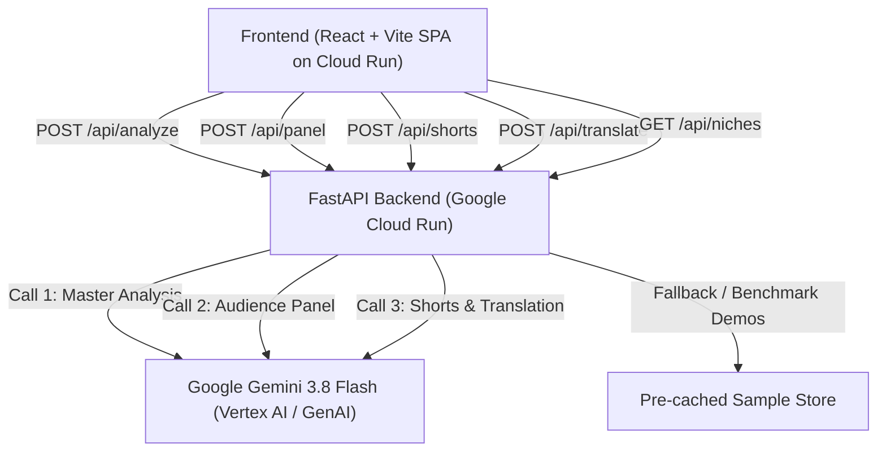

# 🎥 Explainable Video Coach (ClipSense)

> **AI Builder Cup 2026** — An explainable AI feedback engine for YouTube creators, powered by **Google Gemini 3.8 Flash** and deployed on **Google Cloud Run**.

[](https://clipsense-frontend-bjwunoxzmq-uc.a.run.app/)

🌐 **Live Deployed Application:** [https://clipsense-frontend-bjwunoxzmq-uc.a.run.app/](https://clipsense-frontend-bjwunoxzmq-uc.a.run.app/)

---

## 📌 Overview

**Explainable Video Coach** analyzes YouTube videos to provide structured, evidence-linked feedback rather than generic AI advice. Every insight, hook score, and title recommendation cites a precise timestamp from the video.

It features a **Simulated Audience Panel** that evaluates content through three distinct viewer personas tailored to your video's niche, surfacing genuine trade-offs and audience disagreements before publishing.

### 🌟 Supported Video Niches & Dynamic Personas

The system dynamically adapts its rubrics and simulated audience to your video's vertical:

| Niche / Category | Persona 1 | Persona 2 | Persona 3 |
|---|---|---|---|
| **🏋️ Fitness & Exercise** *(Flagship)* | **Gym Beginner**<br>*(Form safety, no jargon)* | **Experienced Lifter**<br>*(Biomechanical cues, efficiency)* | **Home Workout Viewer**<br>*(Apartment space, no equipment)* |
| **💻 Tech & Programming** | **Junior Developer**<br>*(Step-by-step setup, no skipped steps)* | **Senior Architect**<br>*(Code architecture, security, scalability)* | **Pragmatic Builder**<br>*(Fast time-to-value, copy-paste patterns)* |
| **🍳 Cooking & Recipes** | **Novice Home Cook**<br>*(Clear heat & visual cues, exact measurements)* | **Seasoned Foodie**<br>*(Authentic culinary techniques, layering)* | **Busy Weeknight Cook**<br>*(<30 mins, 1 pot, simple supermarket staples)* |
| **🎓 Education & Explainers** | **Curious Novice**<br>*(Intuitive analogies, zero gatekeeping)* | **Domain Specialist**<br>*(Fact checking, scientific nuance, depth)* | **Action-Oriented Learner**<br>*(Practical takeaways & frameworks)* |
| **🌐 General Video** | **Casual Viewer**<br>*(Retention, pacing, entertainment)* | **Critical Analyst**<br>*(Substantiated claims, intellectual honesty)* | **Pragmatic Practitioner**<br>*(Replicable steps & direct application)* |

---

### Key Capabilities

1. **Video Understanding & Moment Extraction:** Generates an accurate 2–3 sentence overview and extracts 6–10 structured chapters/moments with clickable timestamps.
2. **Hook Analysis (First 30s):** Scores opening hook quality across 4 rubric dimensions (**Clarity**, **Curiosity**, **Pacing**, **Payoff Promise**) with specific timestamped observations and suggestions.
3. **Title & Hook Alternatives:** Evaluates the existing title and generates 3 rubric-tested alternatives with clear pros and cons.
4. **Content Readiness Score:** Provides a 0–100 composite score across 4 factors (Hook Strength, Content Structure, Pacing, Title Fit) with top 3 prioritized action items.
5. **Simulated Audience Panel:** Evaluates the video through 3 distinct niche-specific viewer lenses.
6. **Audience Disagreement Matrix:** Identifies moments where personas hold opposing views, helping creators make intentional editorial decisions.
7. **"Inspect AI Reasoning" Transparency:** Exposes the raw structured prompts used by Gemini for full explainability and judge verification.
8. **Pre-cached Sample Demos:** Includes curated fitness videos for instantaneous zero-latency demos.

---

## 🏗️ Architecture & Tech Stack



- **Backend:** Python 3.11, FastAPI, Pydantic v2, `google-genai` SDK, Uvicorn
- **AI Model:** Google Gemini 3.8 Flash (Vertex AI / Google GenAI SDK)
- **Deployment:** Google Cloud Run (Containerized via Docker with Nginx reverse proxy)
- **Security:** `X-API-Key` verification, IP sliding rate limiting, in-flight deduplication


---

## 🚀 How to Run the Backend

### Prerequisites
- Python 3.11+
- Google Cloud Project with Vertex AI enabled **OR** a Gemini Developer API Key

---

### Step 1: Environment Setup

1. Copy `.env.example` to `.env`:
   ```bash
   cp .env.example .env
   ```

2. Open `.env` and fill in your credentials:
   ```env
   # Option A: Google Cloud Vertex AI (Cloud Run production — recommended)
   GCP_PROJECT_ID=your-gcp-project-id
   GCP_REGION=global
   GEMINI_MODEL=gemini-3.8-flash

   # Option B: Gemini Developer API Key (Optional local testing)
   GEMINI_API_KEY=your-gemini-api-key-here

   # Public Protection (Rate limiting & in-flight deduplication active by default)
   REQUIRE_API_KEY=false
   ALLOWED_ORIGINS=http://localhost:5173,http://localhost:3000
   ```

---

### Step 2: Virtual Environment & Dependencies

From the repository root or `backend/` directory:

```bash
# Navigate to backend
cd backend

# Create virtual environment (if not already created)
python3 -m venv .venv

# Activate virtual environment
# On macOS / Linux:
source .venv/bin/activate
# On Windows:
# .venv\Scripts\activate

# Install required packages
pip install --upgrade pip
pip install -r requirements.txt
```

---

### Step 3: Start the Backend Server

With the virtual environment active:

```bash
uvicorn main:app --reload --host 0.0.0.0 --port 8080
```

The server is now live at:
- **Base URL:** `http://localhost:8080`
- **Interactive Swagger Docs:** `http://localhost:8080/docs`
- **ReDoc:** `http://localhost:8080/redoc`

---

## 🧪 Running Automated Tests

Run the test suite to verify all endpoints, dynamic categories, schema validation, honest caching, title resolution, and timestamp clamping:

```bash
cd backend
python test_backend.py
```

**Expected output:**
```
Ran 13 tests in 8.5s

OK
```

---

## 📡 API Reference

### 1. Health Check
```http
GET /api/health
```
**Response:**
```json
{
  "status": "ok",
  "timestamp": 1776151440.0,
  "model": "gemini-3.8-flash"
}
```

---

### 2. List Available Niches & Personas
```http
GET /api/niches
```
**Response:**
```json
{
  "niches": {
    "fitness": {
      "key": "fitness",
      "display_name": "Fitness & Exercise",
      "description": "fitness and exercise instructional videos",
      "personas": ["Gym Beginner", "Experienced Lifter", "Home Workout Viewer"]
    },
    "tech": {
      "key": "tech",
      "display_name": "Tech & Programming",
      "description": "programming tutorials, software development guides, and tech walk-throughs",
      "personas": ["Junior Developer", "Senior Architect", "Pragmatic Builder"]
    },
    "cooking": {
      "key": "cooking",
      "display_name": "Cooking & Recipes",
      "description": "recipe demonstrations and culinary instructional videos",
      "personas": ["Novice Home Cook", "Seasoned Foodie", "Busy Weeknight Cook"]
    },
    "education": {
      "key": "education",
      "display_name": "Education & Explainers",
      "description": "educational explainers, science/history breakdowns, and conceptual lectures",
      "personas": ["Curious Novice", "Domain Specialist", "Action-Oriented Learner"]
    },
    "general": {
      "key": "general",
      "display_name": "General Video",
      "description": "general informational and tutorial YouTube videos",
      "personas": ["Casual Viewer", "Critical Analyst", "Pragmatic Practitioner"]
    }
  }
}
```

---

### 3. Get Curated Demo Samples
```http
GET /api/samples
```
Returns curated sample videos for instant testing without manual typing:
- `sample1`: 5 Essential Dumbbell Exercises for Beginners
- `sample2`: How To Squat With Proper Form (Step-By-Step Checklist)
- `sample3`: 20-Minute No Equipment Full Body HIIT (Apartment Friendly)

---

### 4. Master Video Analysis (Gemini Call 1)
```http
POST /api/analyze
Content-Type: application/json
X-API-Key: your-api-key (optional if not configured in .env)
```
**Request Body:**
```json
{
  "youtube_url": "https://www.youtube.com/watch?v=U0bhE67HuDY",
  "video_duration": 620,
  "video_title": "5 Essential Dumbbell Exercises for Beginners | Full Body Routine",
  "category": "fitness"
}
```
*(Supported `category` values: `"fitness"`, `"tech"`, `"cooking"`, `"education"`, `"general"`)*

**Response:**
```json
{
  "success": true,
  "data": {
    "summary": "A foundational full-body dumbbell workout...",
    "moments": [
      {
        "timestamp_seconds": 75,
        "title": "Exercise 1: Goblet Squat Setup",
        "description": "Demonstrates vertical torso posture..."
      }
    ],
    "hook_score": 8.5,
    "hook_dimensions": [
      {
        "name": "Clarity",
        "score": 9,
        "timestamp_seconds": 6,
        "observation": "Direct verbal statement within 6s.",
        "suggestion": "Keep bullet points on-screen longer."
      }
    ],
    "current_title_assessment": "Clear and searchable...",
    "title_alternatives": [
      {
        "title": "Build Full-Body Strength With Just 2 Dumbbells",
        "strengths": "Directly targets minimal equipment benefit.",
        "weaknesses": "Omits the specific number 5.",
        "rubric_score": 9
      }
    ],
    "recommended_title_index": 0,
    "readiness_score": 86,
    "score_factors": [
      { "name": "Hook Strength", "score": 21, "evidence": "..." }
    ],
    "top_improvements": ["..."]
  },
  "prompt_used": "You are an expert video content analyst...",
  "model_used": "gemini-3.8-flash",
  "is_cached": false
}
```

---

### 5. Simulated Audience Panel (Gemini Call 2)
```http
POST /api/panel
Content-Type: application/json
X-API-Key: your-api-key (optional if not configured in .env)
```
**Request Body:**
```json
{
  "youtube_url": "https://www.youtube.com/watch?v=U0bhE67HuDY",
  "analysis_context": "A foundational full-body dumbbell workout designed for beginners...",
  "video_duration": 620,
  "category": "fitness"
}
```
**Response:**
```json
{
  "success": true,
  "data": {
    "panel_reactions": [
      {
        "persona": "Gym Beginner",
        "overall_rating": "Welcoming, Confidence-Building, and Safe",
        "highlights": [
          { "timestamp_seconds": 80, "reaction": "...", "sentiment": "positive" }
        ],
        "concerns": [
          { "timestamp_seconds": 305, "reaction": "...", "sentiment": "negative", "suggestion": "..." }
        ]
      }
    ],
    "disagreements": [
      {
        "timestamp_seconds": 305,
        "topic": "Bench Press vs Floor Press",
        "persona_1": "Puzzled about how to set up without a gym bench.",
        "persona_2": "Prefers standard bench for full range of motion.",
        "persona_3": "Needs a floor press demonstration for apartment living."
      }
    ]
  },
  "prompt_used": "You are an expert audience simulation engine..."
}
```

---

### 6. YouTube Shorts Clip Suggestions (Feature 8)
```http
POST /api/shorts
Content-Type: application/json
X-API-Key: your-api-key (optional if not configured in .env)
```
**Request Body:**
```json
{
  "youtube_url": "https://youtu.be/S6jy0T85DFs?si=iWUgmfF34PkltVuN",
  "analysis_context": "AI System Design fundamentals video",
  "video_duration": 300,
  "category": "education"
}
```
**Response:**
```json
{
  "success": true,
  "data": [
    {
      "start_seconds": 79,
      "end_seconds": 121,
      "duration_seconds": 42,
      "title": "Why Your AI Prototype Isn't Production-Ready",
      "hook_caption": "Why your AI chatbot will fail in production 🚨",
      "reason_standalone": "Explains why prototype code breaks when deployed to 10k users without needing full architecture context."
    }
  ],
  "prompt_used": "You are an expert short-form video strategist..."
}
```

---

### 7. Multilingual Feedback Translation (Feature 7)
```http
POST /api/translate
Content-Type: application/json
X-API-Key: your-api-key (optional if not configured in .env)
```
**Request Body:**
```json
{
  "target_language": "Hindi",
  "summary": "This video breaks down the fundamentals of AI System Design.",
  "top_improvements": [
    "Front-load the opening with the problem statement.",
    "Use lower-third overlays for speaker credentials."
  ],
  "title_alternatives": [
    "AI System Design: Prototype to Production"
  ]
}
```
**Response:**
```json
{
  "success": true,
  "data": {
    "target_language": "Hindi",
    "translated_summary": "यह वीडियो AI सिस्टम डिज़ाइन के बुनियादी सिद्धांतों को विस्तार से समझाता है।",
    "translated_improvements": [
      "वीडियो की शुरुआत में ही समस्या के विवरण को सामने रखें।",
      "वक्ता के परिचय को दिखाने के लिए लोअर-थर्ड ओवरले का उपयोग करें।"
    ],
    "translated_titles": [
      "AI सिस्टम डिज़ाइन: प्रोटोटाइप से प्रोडक्शन तक"
    ]
  }
}
```

---

## 🐳 Docker & Cloud Run Deployment

### Local Docker Build & Test
```bash
cd backend
docker build -t video-coach-backend .
docker run -p 8080:8080 --env-file ../.env video-coach-backend
```

### Deploy to Google Cloud Run
```bash
# Set your GCP Project ID and Region
export PROJECT_ID="YOUR_GCP_PROJECT_ID"
export REGION="us-central1"

gcloud config set project $PROJECT_ID

# Deploy clipsense-backend from repo root
gcloud run deploy clipsense-backend \
  --source ./backend \
  --project="$PROJECT_ID" \
  --region="$REGION" \
  --allow-unauthenticated \
  --timeout=300 \
  --min-instances=0 \
  --max-instances=2 \
  --set-env-vars="GCP_PROJECT_ID=${PROJECT_ID},GCP_REGION=${REGION},GEMINI_MODEL=gemini-3.8-flash,USE_SAMPLE_CACHE_ONLY=false"
```

### 🌐 Live Deployed Services on Google Cloud Run

| Component | Status | Live URL |
| :--- | :--- | :--- |
| **Frontend Web App** | 🟢 Live | **[https://clipsense-frontend-bjwunoxzmq-uc.a.run.app/](https://clipsense-frontend-bjwunoxzmq-uc.a.run.app/)** |
| **FastAPI Backend** | 🟢 Live | `https://clipsense-backend-962363545501.us-central1.run.app/api/health` |

---


## 📂 Project Structure

```
AI Builder cup/
├── .env.example              # Environment variables template
├── .gitignore                # Git exclusions (venv, env secrets, pycache, dist)
├── README.md                 # Complete documentation and run guide
├── deploy_backend.sh         # 1-Click Cloud Run backend deployment script
├── deploy_frontend.sh        # 1-Click Cloud Run frontend deployment script
├── implimentation_plan.md    # 6-day competition implementation blueprint
│
├── backend/                  # Python 3.11 FastAPI Backend
│   ├── .venv/                # Local Python virtual environment
│   ├── Dockerfile            # Container definition for Cloud Run
│   ├── requirements.txt      # Python dependencies
│   ├── main.py               # FastAPI endpoints, IP rate limiter, CORS, deduplication
│   ├── gemini_service.py     # Gemini 3.8 Flash multi-niche orchestration & fallback
│   ├── niches.py             # 5 Category definitions & persona rubrics
│   ├── schemas.py            # Pydantic v2 schemas and response models
│   ├── sample_data.py        # Pre-cached sample video data & translations
│   ├── test_backend.py       # Automated unit test suite (13/13 passing)
│   └── prompts/
│       ├── master_analysis.txt  # Call 1 prompt (Moments + Hook + Titles + Readiness)
│       ├── audience_panel.txt   # Call 2 prompt (3 Personas + Disagreements)
│       └── shorts_clips.txt     # Tier 3 prompt (YouTube Shorts clip suggestions)
│
└── frontend/                 # React 19 + Vite Frontend SPA
    ├── Dockerfile            # Multi-stage production build container
    ├── nginx.conf            # Nginx reverse proxy configuration for Cloud Run
    ├── package.json          # Node dependencies & build scripts
    ├── vite.config.js        # Vite dev server configuration & local proxy
    ├── index.html            # Main HTML entry point & typography
    └── src/
        ├── App.jsx           # Main state orchestration & analysis pipeline
        ├── api.js            # Fetch client for backend endpoints with abort support
        ├── index.css         # Cyber dark design system & micro-animations
        └── components/
            ├── Header.jsx                # Branding & Inspect Prompts trigger
            ├── UrlInput.jsx              # URL input, dynamic niches, 1-click demos
            ├── VideoPlayer.jsx           # YouTube player with cueVideoById & seek
            ├── ProgressTracker.jsx       # Glowing circular loader with live steps
            ├── MomentCard.jsx            # Video chapters with clickable timestamps
            ├── HookAnalysis.jsx          # 4 Rubric dimensions with evidence badges
            ├── TitleComparison.jsx       # Title evaluation & 3 alternatives
            ├── ReadinessScore.jsx        # 0–100 composite score & factor breakdown
            ├── AudiencePanel.jsx         # 3 Persona tabs & Disagreements Matrix
            ├── ShortsClips.jsx           # Viral Shorts candidates (<60s)
            ├── LanguageTranslate.jsx     # Multilingual feedback (Tamil, Hindi, etc.)
            ├── InspectReasoningModal.jsx # Full transparency prompts & scoring modal
            └── ErrorBoundary.jsx         # Isolated UI error protection boundary
```

