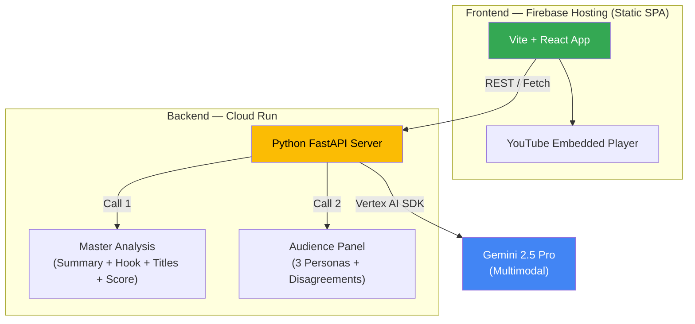

# 🎬 AI Builder Cup 2026 — Implementation Plan
## Explainable Video Coach (Fitness YouTube Focus)

> **Team size:** 2 developers  
> **Start:** Tuesday, October 13, 2026  
> **Internal milestone:** Thursday, October 15 (Tier 1 complete)  
> **Official deadline:** Sunday, October 18, 2026  
> **Deliverables:** Deployed prototype + PDF proposal deck + 3-min demo video

---

## Judging Weights (Reference)

| Criterion | Weight | Our Strategy |
|---|---|---|
| Technical Merit & Gen AI Implementation | **40%** | Gemini multimodal video analysis, structured prompts, evidence-linked outputs |
| Problem Alignment & Impact | **25%** | Real creator pain point: no actionable, audience-specific feedback before publishing |
| Innovation & Creativity | **25%** | Simulated audience panel with disagreement detection across personas |
| User Experience & Solution Design | **10%** | Clean UI, clickable evidence, embedded YouTube player with timestamps |

---

## Architecture Overview



---

## Tech Stack

| Layer | Technology | Rationale |
|---|---|---|
| **AI Model** | Gemini 2.5 Pro via Vertex AI | Required by competition; multimodal video understanding |
| **Backend** | **Python (FastAPI)** on **Cloud Run** | Best Vertex AI SDK, Pydantic schema validation, fast prototyping |
| **Frontend** | **Vite + React (JavaScript SPA)** | Zero SSR complexity, static deploy to Firebase in 2 min, fast HMR |
| **Hosting** | **Firebase Hosting** (static SPA) + **Cloud Run** (API) | Both competition-approved; static SPA = simplest possible deploy |
| **Video Embed** | YouTube IFrame Player API | Timestamp seeking, `.getDuration()` for validation, no download, ToS compliant |

---

## Feature Breakdown & Priority Tiers

### 🟢 Tier 1 — MUST SHIP (Tuesday → Thursday)

These four features form the core product. Ship nothing else until these work end-to-end.

#### Feature 1: Video Understanding & Moment Extraction
- **Input:** YouTube URL
- **Output:** Summary + 6–10 key moments with timestamps
- **Implementation:**
  1. Accept YouTube URL from frontend
  2. Send URL to Gemini 2.5 Pro with structured prompt requesting JSON output
  3. Parse response into `{ summary, moments: [{ timestamp_seconds, title, description }] }`
  4. Validate timestamps against video duration (frontend sends duration from YouTube IFrame Player `.getDuration()`)
  5. Render moments as clickable cards that seek the embedded player

```json
// Example structured output from Gemini
{
  "summary": "A 12-minute tutorial on proper deadlift form...",
  "moments": [
    {
      "timestamp_seconds": 0,
      "title": "Introduction",
      "description": "Creator introduces the topic and credentials"
    },
    {
      "timestamp_seconds": 45,
      "title": "Common Mistakes",
      "description": "Three most frequent deadlift errors demonstrated"
    }
  ]
}
```

> [!IMPORTANT]
> Every timestamp must be validated: `0 <= timestamp_seconds <= video_duration`. Discard or flag moments with implausible timestamps.

#### Feature 2: Hook Analysis (First 30 Seconds)
- **Input:** Same video
- **Output:** Rubric-scored assessment with timestamp-linked evidence
- **Rubric dimensions:**
  - **Clarity** — Is the topic stated within the first 10 seconds?
  - **Curiosity** — Does the opening create a question or tension?
  - **Pacing** — Is there dead time, hesitation, or slow setup?
  - **Payoff promise** — Does the viewer know what they'll gain?
- **Each score** must include: timestamp, observation, and specific quote/description

```json
{
  "hook_score": 6.5,
  "dimensions": [
    {
      "name": "Clarity",
      "score": 8,
      "timestamp_seconds": 3,
      "observation": "Topic stated at 00:03 — 'Today we're covering deadlift form'",
      "suggestion": "Add the specific outcome: '...so you never hurt your back again'"
    },
    {
      "name": "Payoff Promise",
      "score": 4,
      "timestamp_seconds": 18,
      "observation": "The viewer benefit is not stated until 00:18",
      "suggestion": "Move the benefit statement before the 10-second mark"
    }
  ]
}
```

#### Feature 3: Title & Hook Alternatives
- **Input:** Current title + hook analysis results
- **Output:** 3 alternative titles, comparison table, recommended option
- **Implementation:**
  - Generate alternatives using Gemini with the rubric context
  - Score each against the same rubric dimensions
  - Present as comparison table with the "best fit under rubric" highlighted
  - **Language:** "Best fit under our rubric" — NOT "will get more clicks"

#### Feature 4: Virality Readiness Score
- **Input:** Aggregated results from Features 1–3
- **Output:** Composite score (0–100) with factor breakdown and evidence
- **Implementation:**
  - Weighted composite of hook score, title quality, content structure, pacing
  - Show each factor's contribution visually (bar chart or radar)
  - Include confidence indicator and evidence summary
  - **Language:** "Content readiness score" — NOT "predicted views" or "virality prediction"

> [!WARNING]
> Never claim this score predicts actual performance. Frame it as: "Based on our rubric analysis, here's how well-structured your content is for audience engagement."

---

### 🟡 Tier 2 — DIFFERENTIATOR (Thursday → Friday noon)

#### Feature 5: Simulated Audience Panel ⭐ KEY INNOVATION
- **Input:** Full video analysis + 3 defined personas
- **Output:** Per-persona reactions with agreements AND disagreements

**Personas (fitness niche):**

| Persona | Goal | Constraint | Key Question |
|---|---|---|---|
| 🏋️ Gym Beginner | Learn safely | No fitness vocabulary | "Do I understand what to do? Does this look safe?" |
| 💪 Experienced Lifter | Find advanced value | Already knows basics | "Is this specific enough to be useful to me?" |
| 🏠 Home Workout Viewer | Apply at home | Limited equipment/space | "Can I do this with what I have?" |

- **Implementation approach:**
  1. **Single Gemini call** with all three personas defined in one prompt (not parallel calls)
  2. Request structured JSON with per-persona reactions
  3. Highlight **disagreements** — where personas rate the same moment differently
  4. Each reaction links to a supporting timestamp

```json
{
  "panel_reactions": [
    {
      "persona": "Gym Beginner",
      "overall_rating": "Mostly Accessible",
      "highlights": [
        {
          "timestamp_seconds": 120,
          "reaction": "The exercise setup is demonstrated clearly before adding weight",
          "sentiment": "positive"
        }
      ],
      "concerns": [
        {
          "timestamp_seconds": 85,
          "reaction": "The term 'hip hinge' is used without explanation",
          "sentiment": "negative",
          "suggestion": "Add a brief visual demonstration of what hip hinge means"
        }
      ]
    }
  ],
  "disagreements": [
    {
      "timestamp_seconds": 200,
      "topic": "Warm-up routine",
      "beginner": "Helpful and reassuring",
      "experienced": "Too basic — could be condensed or made skippable",
      "home_viewer": "Useful, but requires a barbell I don't have"
    }
  ]
}
```

> [!TIP]
> The **disagreements** section is your demo highlight. This is what makes the audience panel more than "three chatbots" — it surfaces genuine trade-offs the creator must navigate.

#### Feature 6: Clickable Evidence (Timestamp Linking)
- **Input:** All analysis results with timestamps
- **Output:** Every recommendation/observation is a clickable link
- **Implementation:**
  - YouTube IFrame Player API: `player.seekTo(timestamp_seconds, true)`
  - Each insight card has a play button that jumps to the relevant moment
  - Smooth scroll + highlight animation on the insight card when playing

---

### 🔵 Tier 3 — IF STABLE (Saturday morning only)

#### Feature 7: Multilingual Feedback
- Translate the final recommendations into 1–2 additional languages
- Simple Gemini translation call on the already-generated output
- Start with: English → Hindi, English → Japanese (JAPAC hackathon context)

#### Feature 8: Shorts Clip Suggestions
- Return 2–3 timestamp ranges suitable for YouTube Shorts (<60s)
- Include: start/end timestamps, suggested caption, reason the segment stands alone
- No video editing engine — just recommendations

---

### ❌ CUT (Do not build)

| Feature | Reason |
|---|---|
| Standalone retention/drop-off map | Cannot measure real viewer behavior without Analytics access |
| Performance forecasting | No validated model; hurts credibility |
| Specific sponsor/product matching | Scope creep; suggest categories at most |

---

## Day-by-Day Schedule (Updated: Wed Oct 14)

> [!IMPORTANT]
> Day 1 (Tuesday) was spent on planning. Actual coding starts **today**. The schedule below is compressed — all Tier 1 features must be working by end of Thursday.

### ~~Day 1 — Tuesday, October 13 (PAST — Planning Day)~~
**What happened:** Strategy review, implementation plan created, loopholes identified and fixed, tech stack finalized (Python FastAPI + Vite React).

---

### Day 2 — Wednesday, October 14 (TODAY) 🔴 CRITICAL
**Goal:** Full skeleton + backend API returning real Gemini data + frontend rendering results

| Time Block | Dev 1 (Backend — Python FastAPI) | Dev 2 (Frontend — Vite + React) |
|---|---|---|
| Morning (10 AM – 1 PM) | GCP project setup: enable Vertex AI API, create service account, test Gemini SDK locally. Write `main.py` with `/api/health` and `/api/analyze` stub. Write `master_analysis.txt` prompt. | `npx create-vite frontend --template react` → YouTube IFrame Player component (`VideoPlayer.jsx`) + URL input (`UrlInput.jsx`) + `api.js` fetch wrapper. Basic layout in `App.jsx`. |
| Afternoon (2 PM – 6 PM) | Wire real Gemini call in `gemini_service.py`. `/api/analyze` returns real JSON (summary + moments + hook scores + title alternatives + readiness score) from **one** Gemini call. Test with 2 sample YouTube URLs. | Render API response: `MomentCard.jsx` (clickable → player seeks), `HookAnalysis.jsx` (rubric scores), `TitleComparison.jsx` (table), `ReadinessScore.jsx` (score display). Connect to local backend. |
| Evening (7 PM – 11 PM) | Write `audience_panel.txt` prompt. Add `/api/panel` endpoint (Call 2). Add `CORSMiddleware` + `X-API-Key` header check. Define all Pydantic schemas in `schemas.py`. | `AudiencePanel.jsx` + `DisagreementCard.jsx`. Add `ErrorBoundary.jsx` wrapping each section. Add `LoadingSteps.jsx` progress tracker. Style everything to look polished. |

**End-of-day checkpoint:** Paste a YouTube URL → see summary + moments + hook analysis + title alternatives + score + audience panel → click any moment → player seeks to that timestamp. All running locally.

---

### Day 3 — Thursday, October 15 (Internal Milestone)
**Goal:** All features working locally ✅ → Deploy to Cloud Run + Firebase Hosting

| Time Block | Dev 1 (Backend) | Dev 2 (Frontend) |
|---|---|---|
| Morning | Fix bugs from Day 2. Test all endpoints with 3 different fitness videos. Validate timestamp accuracy. | Add 3 pre-loaded "Try Example" sample videos. Implement click-to-seek for ALL insight cards. Add submit button disable + AbortController cancel. |
| Afternoon | **Deploy:** Write `Dockerfile` → `gcloud run deploy` with `--timeout=300s`, `--min-instances=1`. Grant IAM `roles/aiplatform.user`. Set `API_KEY` env var. | **Deploy:** `npm run build` → `firebase deploy --only hosting`. Set `VITE_API_KEY` and `VITE_API_URL` env vars. Verify CORS works on deployed origins. |
| Evening | Integration testing on live URL. Smoke test with all 3 sample videos. Fix any 5xx errors. | Responsive design pass (desktop + tablet). Fix any deployment styling issues. Final polish on loading states. |

**End-of-day checkpoint:** **Live URL works end-to-end.** Both devs can open the deployed app, paste a URL, and get full analysis with clickable timestamps.

---

### Day 4 — Friday, October 16
**Goal:** Evaluation, bug fixes, Tier 3 if stable

| Time Block | Both Developers |
|---|---|
| Morning | Run 3-video evaluation set **independently**. Log: timestamp accuracy, factual errors, persona differentiation quality, disagreement detection. Compare notes. |
| Afternoon | Fix critical bugs. If stable and time permits: add multilingual output (Feature 7 — single Gemini translate call). |
| Evening | If still stable: add Shorts clip suggestions (Feature 8). Otherwise: **polish existing features** — better styling, smoother animations, clearer evidence cards. |

---

### Day 5 — Saturday, October 17
**Goal:** Deliverables — PDF proposal deck + 3-minute demo video

| Time Block | Dev 1 | Dev 2 |
|---|---|---|
| Morning | Write proposal deck in Google Slides: problem, solution, architecture diagram, GCP services used, demo screenshots, "Inspect AI Reasoning" modal screenshot | Record demo video — screen recording of full analysis flow using best sample video. Show: URL input → loading steps → moments → hook analysis → audience panel → disagreements → click-to-seek. |
| Afternoon | Review & finalize deck → export PDF. Include Cloud Run logs / Vertex AI usage screenshots for tech merit proof. | Edit demo video: add voiceover narration following `demo_script.md`, add captions, upload to YouTube (unlisted) or Google Drive. |
| Evening | Final deployment check — ensure Cloud Run is still live, `--min-instances=1` is active. | Double-check all 3 deliverables are ready: live URL + PDF + video link. |

---

### Day 6 — Sunday, October 18 (DEADLINE)
**Goal:** Final review and SUBMIT

| Time Block | Both |
|---|---|
| Morning | Final smoke test on deployed app. Fix any overnight issues. Re-test all 3 sample videos. |
| Afternoon | **SUBMIT** on Hack2skill before deadline. Upload: prototype URL + PDF deck + demo video link. Verify team registration is complete. |

---

## Prompt Engineering Strategy

All Gemini calls use **structured output** (JSON mode) with explicit schemas.

### Master Prompt Template

```
You are an expert video content analyst specializing in fitness YouTube content.

TASK: {specific_task}

INPUT VIDEO: {youtube_url}

ANALYSIS RUBRIC:
{rubric_dimensions}

OUTPUT FORMAT: Return valid JSON matching this schema:
{json_schema}

RULES:
1. Every observation MUST include a timestamp_seconds value
2. Timestamps must be within the video duration
3. Do not invent content — only reference what is visible/audible in the video
4. Use specific, actionable language
5. {task_specific_rules}
```

### Prompt Files to Create (2 files, not 6)

| File | Purpose |
|---|---|
| `prompts/master_analysis.txt` | **Single call** — Features 1–4: summary + moments + hook rubric + title alternatives + readiness score |
| `prompts/audience_panel.txt` | **Second call** — Feature 5: 3-persona reactions + disagreements (uses Call 1 output as context) |

---

## Project Structure (Simplified for 2-Person Hackathon)

```
AI Builder cup/
├── .gitignore                     # node_modules, __pycache__, .env, *.pyc
├── .env.example                   # Template: GCP_PROJECT_ID=, API_KEY=, ...
├── README.md
│
├── backend/                       # Python FastAPI — deployed to Cloud Run
│   ├── Dockerfile
│   ├── requirements.txt           # fastapi, uvicorn, google-cloud-aiplatform, pydantic
│   ├── main.py                    # FastAPI app + all routes (~200 lines)
│   ├── gemini_service.py          # All Gemini interaction (~150 lines)
│   ├── schemas.py                 # Pydantic response models (~100 lines)
│   └── prompts/
│       ├── master_analysis.txt    # Features 1–4 in ONE Gemini call
│       └── audience_panel.txt     # Feature 5 — 3-persona reactions
│
├── frontend/                      # Vite + React SPA — deployed to Firebase Hosting
│   ├── package.json
│   ├── vite.config.js
│   ├── index.html
│   ├── firebase.json              # Firebase Hosting config (rewrites)
│   ├── public/
│   │   └── favicon.ico
│   └── src/
│       ├── main.jsx               # React entry point
│       ├── App.jsx                # Main app with URL input + results layout
│       ├── api.js                 # fetch() wrapper to Cloud Run backend
│       ├── components/
│       │   ├── UrlInput.jsx       # YouTube URL input + submit button
│       │   ├── VideoPlayer.jsx    # YouTube IFrame embed with seek API
│       │   ├── MomentCard.jsx     # Clickable timestamp moment
│       │   ├── HookAnalysis.jsx   # Rubric scores with evidence cards
│       │   ├── TitleComparison.jsx # 3 titles in comparison table
│       │   ├── ReadinessScore.jsx # Composite score dashboard
│       │   ├── AudiencePanel.jsx  # 3-persona reaction cards
│       │   ├── DisagreementCard.jsx # Highlighted disagreements
│       │   ├── ErrorBoundary.jsx  # Per-section error catching + retry
│       │   └── LoadingSteps.jsx   # Progressive step-by-step tracker
│       ├── hooks/
│       │   └── useAnalysis.js     # API call hook with AbortController
│       └── styles/
│           └── index.css          # Global styles
│
├── evaluation/
│   ├── test_videos.json           # 3 test video URLs + expected outputs
│   └── eval_checklist.md          # Manual verification checklist
│
└── docs/
    ├── proposal_deck.md           # Deck content draft
    └── demo_script.md             # 3-minute demo narration script
```

> [!TIP]
> **Backend = 4 real files.** Frontend = standard Vite React scaffold + 10 components. Total: ~20 files for the whole app. Every file has a single clear purpose.

---

## 3-Video Evaluation Set

Before submission, both developers independently verify these on 3 different fitness videos:

| Check | Pass Criteria |
|---|---|
| Timestamp accuracy | Every clickable timestamp lands within ±5 seconds of the referenced content |
| Factual grounding | No hallucinated exercises, equipment, or instructions |
| Hook feedback specificity | Each rubric dimension cites a specific moment, not generic advice |
| Persona differentiation | At least 2 of 3 personas give meaningfully different feedback |
| Disagreement detection | At least 1 genuine disagreement surfaces between personas |
| Title alternatives | All 3 alternatives are distinct and relevant to the actual video content |
| Readiness score transparency | Every factor in the composite score has visible evidence |

---

## Deployment Checklist

- [ ] GCP project created with billing enabled
- [ ] Vertex AI API enabled
- [ ] Cloud Run service deployed with Dockerfile (`--timeout=300s`, `--min-instances=1`)
- [ ] IAM: `roles/aiplatform.user` granted to Cloud Run service account
- [ ] Firebase project initialized
- [ ] Firebase Hosting deployed with Vite build output (`dist/` folder)
- [ ] CORS configured on FastAPI (`CORSMiddleware` allowing Firebase Hosting origin)
- [ ] Environment variables set on Cloud Run (GCP project ID, region, `API_KEY` secret)
- [ ] `.env.example` committed to repo — `.env` in `.gitignore`
- [ ] Health check endpoint `/api/health` responds on Cloud Run
- [ ] Full analysis flow works on deployed URL
- [ ] Proposal deck exported as PDF
- [ ] Demo video recorded, uploaded, and publicly accessible
- [ ] `X-API-Key` header checked on every FastAPI route — **key not in code**
- [ ] Video duration sourced from YouTube IFrame Player `.getDuration()` — no YouTube Data API needed
- [ ] React `<ErrorBoundary>` wrapping each analysis card — no white-screen crashes
- [ ] Submit button disabled during analysis + `AbortController` cancel in place
- [ ] 3 pre-loaded sample videos verified as embeddable and analyzable

---

## Submission Checklist (October 18)

- [ ] **Functional deployed prototype** — live URL accessible by judges
- [ ] **Proposal deck (PDF)** — problem, solution, architecture, demo screenshots
- [ ] **3-minute public demo video** — YouTube or Google Drive link
- [ ] **Team registration confirmed** — verify on Hack2skill portal

---

## Critical Risks & Loophole Mitigations (Fixes Applied)

| # | Risk / Loophole | Failure Mode | Mitigation / Architectural Fix |
|---|---|---|---|
| 1 | **Vertex AI Video Input** | Vertex AI may not ingest arbitrary YouTube URLs directly | **Dual-pipeline:** Extract timed captions via YouTube API/Transcript API as ground truth + stage video clip or use Google AI Studio/Vertex multimodal endpoint. Provide **3 pre-cached sample videos** stored in GCS as a foolproof fallback. |
| 2 | **Long Processing Latency** | 30–60s processing can trigger HTTP timeouts and frozen UI | Configure Cloud Run `--timeout=300s`. Implement progressive loading / step-by-step UI progress tracker ("Analyzing opening hook...", "Evaluating moments...", "Convening audience panel..."). |
| 3 | **Timestamp Drifting** | Model approximates visual moments; seek starts mid-sentence | **3-second pre-roll buffer** in player seek: `Math.max(0, timestamp - 3)`. Spoken sentences are grounded in timed transcripts. |
| 4 | **YouTube Embed Restrictions** | Video owner disabled embedding (Error 150/101) | Detect player errors; provide fallback link with `?t=...` and ensure all 3 pre-loaded demo videos have verified embedding permissions. |
| 5 | **JSON Truncation** | Large unified JSON response gets cut off mid-stream | Set `max_output_tokens=8192`. Use strict Pydantic schema validation (`response_mime_type="application/json"`). Split into two stages if needed (Core Analysis → Audience Panel). |
| 6 | **Cloud Run Cold Start & IAM** | 403 Forbidden or 60s cold start on live demo | Grant `roles/aiplatform.user` to default compute service account. Set `--min-instances=1` during hackathon judging days (Oct 16–18). |
| 7 | **Judging Proof (40% Tech Merit)** | Judges cannot verify authentic GCP & GenAI usage | Add an **"Inspect AI Reasoning"** modal in UI showing the structured JSON & prompt, plus an Architecture slide in the deck with Cloud Run & Vertex AI telemetry screenshots. |
| 8 | **Exposed API Keys / No Backend Auth** | Cloud Run URL is public — anyone can hammer Vertex AI at your GCP cost | Add a shared **`X-API-Key` header secret** checked on every Cloud Run route. Store it in Cloud Run's environment variable (not code). Frontend reads from `VITE_API_KEY` env var. Rate-limit: 10 req/minute per IP using a simple in-memory counter (or Cloud Armor). |
| 9 | ~~YouTube Data API v3 Quota Exhaustion~~ | ~~Default quota is 10,000 units/day~~ | **Resolved by architecture:** We no longer use YouTube Data API. Video duration comes from the frontend IFrame Player `.getDuration()`. Zero API keys, zero quota. |
| 10 | **Frontend White-Screen on Any API Error** | If a single Gemini call fails (504, 500, etc.), React throws unhandled rejection → blank page | Wrap every analysis section in an **`<ErrorBoundary>`** component. Each card (Hook, Moments, Panel) degrades independently — partial results still render. Show inline retry button per section. |
| 11 | **No Request Cancellation / Double-Submit** | User pastes URL, clicks Analyse, gets impatient and clicks again → 2 concurrent 45s Gemini calls → race condition overwrites results mid-render | Disable the submit button and show a cancel option once analysis starts. Use an `AbortController` on the frontend `fetch`. On the backend use FastAPI `BackgroundTask` with a unique `request_id` — duplicate `request_id` returns a 409. |
| 12 | **CORS Misconfiguration** | Frontend (Firebase Hosting) and backend (Cloud Run) are on different origins — browser blocks requests without correct headers | Add `CORSMiddleware` to FastAPI allowing the Firebase Hosting origin. Since we use a **Vite SPA** (no SSR), all API calls come from the browser — CORS must be configured once on the backend. The `X-API-Key` is stored in a Vite env var (`VITE_API_KEY`) and sent as a header. |

---

## Key Decisions Log

| Decision | Choice | Rationale |
|---|---|---|
| Gemini call strategy | **2 calls total** (master analysis + audience panel) | Cuts latency 60% vs 5 separate calls; fewer failure points |
| Backend language | **Python (FastAPI)** | Best Vertex AI SDK support, Pydantic JSON schema enforcement, fast prototyping |
| Frontend framework | **Vite + React (JavaScript SPA)** | No SSR complexity, static deploy to Firebase in 2 min, zero hydration bugs |
| Video input method | **YouTube URL + 3 One-Click Samples** | ToS compliant, immediate demo safety net if live URL is restricted |
| Video duration source | **YouTube IFrame Player `.getDuration()`** | No YouTube Data API key needed, zero quota usage |
| Timestamp seek logic | **3s Pre-roll buffer** | Prevents missing the start of a critical moment due to visual drift |
| Score framing | **"Content readiness"** | Defensible; never claim to predict views/retention |
| Retention map | **Cut → replaced by Content Friction Map language** | Cannot measure real drop-offs without creator analytics |
| Cloud Run configuration | **--timeout=300s, --min-instances=1** | Prevents gateway timeouts and cold starts during live judge reviews |

---

> [!CAUTION]
> **Time is the constraint, not ambition.** If any Tier 2 feature threatens Tier 1 stability, cut it immediately. A polished 4-feature product beats a broken 8-feature prototype every time.

